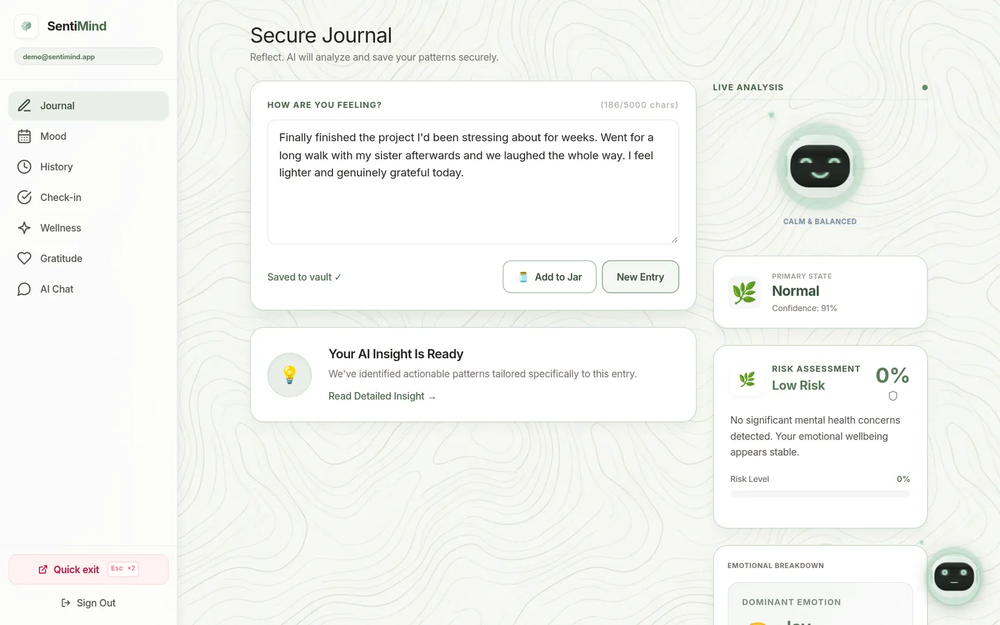
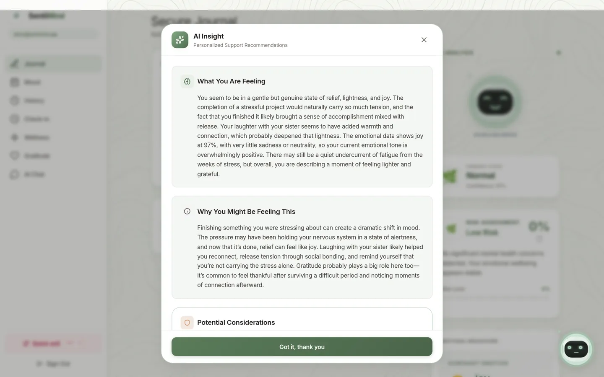
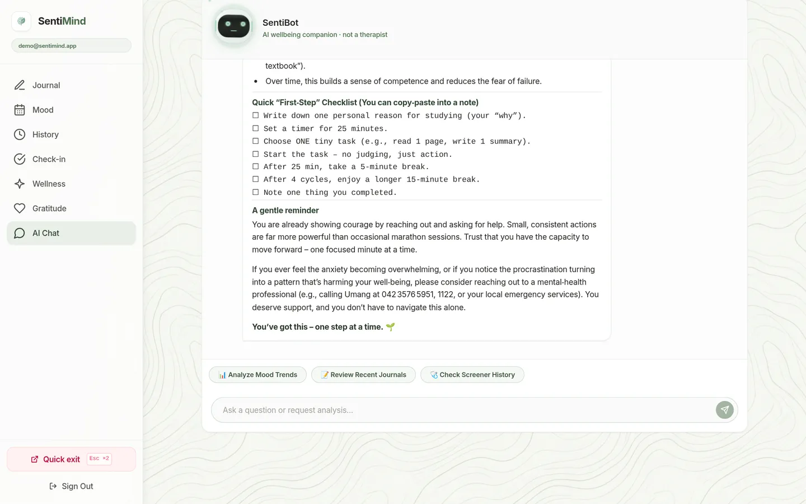
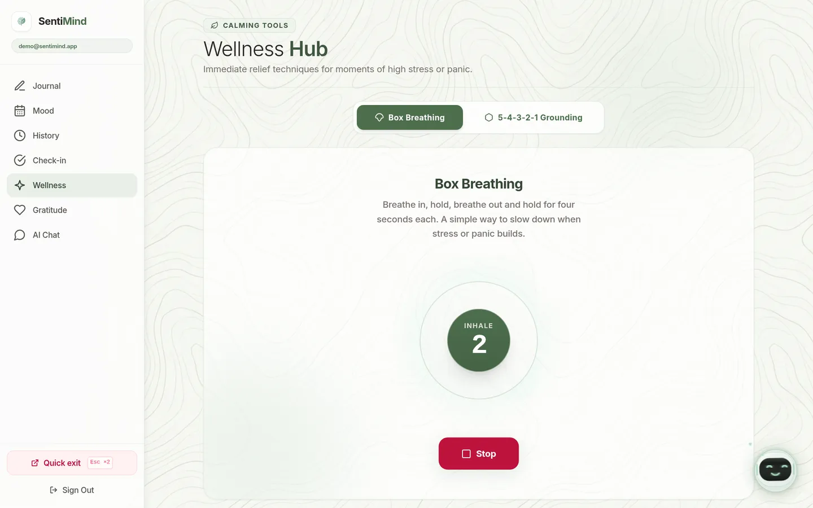
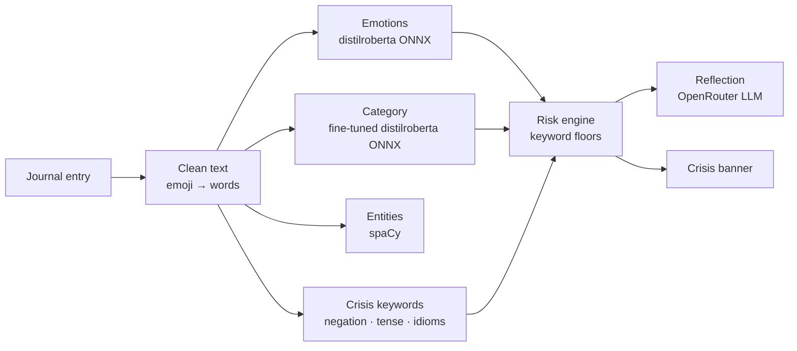

# SentiMind

[](https://github.com/AeonisEnomas/SENTI-MIND/actions/workflows/ci.yml)
[](LICENSE)

A private journaling app that reads each entry for emotion, mood category and risk, then
responds with a short reflection. It runs entirely on free tiers: React on Vercel, FastAPI on
Render and Supabase for auth and Postgres. Both ML models run locally as INT8 ONNX, so
analysis needs no paid inference API.

**Live demo:** [senti-mind-mocha.vercel.app](https://senti-mind-mocha.vercel.app). The API sleeps
when idle, so the first request can take up to a minute.

> SentiMind is a supportive journaling tool, not a medical device. It does not diagnose or
> treat anything, and its models are not clinically validated.



| AI reflection | Chat | Breathing exercise |
|---|---|---|
|  |  |  |

## Features

- **Journal analysis.** Each entry gets 7-class emotion scores, a category (Normal, Stress,
  Anxiety, Depression or Suicidal) with a confidence tier, a risk level and an LLM-written
  reflection. Entries save to the user's history automatically.
- **Crisis safety.** A deterministic keyword engine that handles negation, tense and
  idioms sets risk floors no model can lower. It also screens chat messages before they reach
  the LLM, and the crisis banner still appears if the API is unreachable.
- **Mood tracking.** A 30-day heatmap, trends, history and PDF export.
- **Check-ins.** GAD-2 and PHQ-2 self-check questionnaires with history.
- **Chat.** A wellbeing chat that can attach the user's recent journals, mood trends or
  check-ins as context.
- **Calming tools.** Guided box breathing and 5-4-3-2-1 grounding.
- **Privacy by design.** Row-Level Security on every table, a double-Escape quick exit,
  and no service-role key on the server.

## How it works



Every stage degrades on its own: a missing model returns an empty result rather than a
made-up score, and the LLM falls back to a fixed message. Details are in
[docs/ARCHITECTURE.md](docs/ARCHITECTURE.md).

## Model results

The category classifier was fine-tuned from `distilroberta-base` on about 25,000 texts:
Reddit posts from SWMH and Dreaddit plus a synthetic set. It is evaluated on a held-out fold in which
near-duplicate texts are never split between training and test.

| Model | Macro F1 | Accuracy | Suicidal recall | Stress recall |
|---|---|---|---|---|
| TF-IDF + LinearSVC (fallback) | 0.645 | 0.664 | 0.73 | 0.44 |
| distilroberta, 512 tokens (default) | **0.742** | **0.734** | **0.77** | **0.88** |

The labels come from subreddit membership, not clinicians, and Reddit is only a proxy for
journal writing. [docs/MODEL.md](docs/MODEL.md) covers the data, the evaluation protocol,
the known failure cases, and an earlier model that was discarded because its scores came
from leaked synthetic data.

## Tech stack

| Layer | Tools |
|---|---|
| Frontend | React 18, React Router 7, Vite 5, Tailwind CSS 3, Recharts, Vitest, Testing Library |
| Backend | Python 3.11, FastAPI, Pydantic 2, httpx, pytest, Ruff |
| ML | ONNX Runtime, Hugging Face Tokenizers, scikit-learn, spaCy |
| Data and auth | Supabase (Postgres with Row-Level Security, Auth, `pg_cron`) |
| LLM | OpenRouter (free models with a fallback chain) |
| Infrastructure | Vercel, Render (Docker), GitHub Actions |

## Getting started

Requirements: Python 3.11 or 3.12, Node.js 22, and a free Supabase project.

```bash
git clone https://github.com/AeonisEnomas/SENTI-MIND.git
cd SENTI-MIND
cp .env.example .env      # add your Supabase URL and anon key
./start.sh                # creates the venv, installs everything, starts both servers
```

The app runs at http://127.0.0.1:5173 and the API at http://127.0.0.1:8000 (interactive
docs at `/docs`). To set it up by hand instead:

```bash
# API
cd backend
python3.11 -m venv .venv && source .venv/bin/activate
pip install -r requirements-dev.txt
python -m uvicorn app.main:app --reload --port 8000

# Web (in a second terminal)
cd frontend
npm install
npm run dev
```

### Configuration

A single `.env` at the repository root configures both apps; every variable is documented
in [.env.example](.env.example).

| Variable | Required | Purpose |
|---|---|---|
| `SUPABASE_URL`, `SUPABASE_ANON_KEY` | yes | API access to Supabase |
| `VITE_SUPABASE_URL`, `VITE_SUPABASE_ANON_KEY` | yes | Frontend sign-in |
| `OPENROUTER_API_KEY` | no | LLM reflections and chat; without it the app uses fixed responses |
| `VITE_API_URL` | no | API base URL (default `http://localhost:8000/api/v1`) |
| `ALLOWED_ORIGINS`, `ENVIRONMENT` | production | CORS origins; `production` turns off `/docs` |

## Testing

```bash
cd backend && pytest && ruff check .                     # 250 tests
cd frontend && npm run lint && npm test && npm run build  # 56 tests
```

CI runs both suites on every pull request. The backend tests use a fake Supabase client and
mocked HTTP, so they need no keys or network access.
`tests/test_risk_safety_regressions.py` pins the crisis-detection behaviour and must always
pass.

## Deployment

- **API:** Render web service built from `backend/Dockerfile` (`render.yaml` is a ready-made
  Blueprint). Set `ENVIRONMENT=production`, the Supabase variables, `OPENROUTER_API_KEY` and
  `ALLOWED_ORIGINS`.
- **Web:** Vercel project with `frontend/` as its root and the `VITE_*` variables set.
- **Database:** apply `supabase/migrations/`. The `pg_cron` job pings `/keepalive` every 10
  minutes, so neither free tier goes to sleep for long.

## Project structure

```
backend/
  app/
    api/        HTTP routes, auth dependency, rate limiting
    core/       settings, constants, crisis detection, classifier preprocessing
    models/     emotion and category models, LLM insight, schemas
    services/   risk engine, chat agent, OpenRouter client, NER, keep-alive
  data/         v7 fallback model and metadata (hashes, metrics, provenance)
  scripts/      data generation, ingestion, training, evaluation, model download
  tests/
frontend/src/
  pages/        route components
  layouts/      authenticated shell
  components/   shared UI
  lib/          pure, unit-tested logic
  services/     API clients
docs/           architecture, model card, fine-tuning log, screenshots
supabase/       SQL migrations
```

## Crisis support

If you are struggling, please reach out to someone now.
In Pakistan: **Umang** 042 3576 5951, or **Rescue 1122** for emergencies. Elsewhere, see the
[IASP crisis centre directory](https://www.iasp.info/resources/Crisis_Centres/).

## License

The code is released under the [MIT License](LICENSE). The SWMH and Dreaddit datasets, and
the classifier weights fine-tuned on them, are for non-commercial research use only.

Built by Abdullah Mushtaq.
